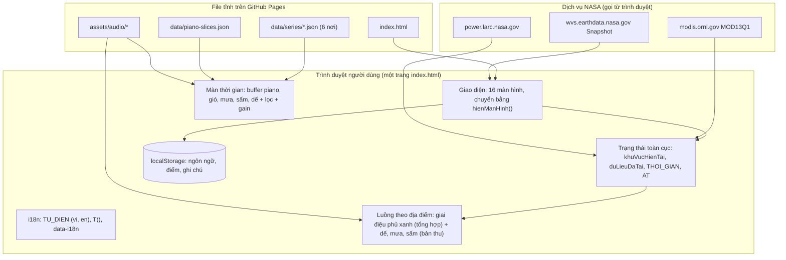
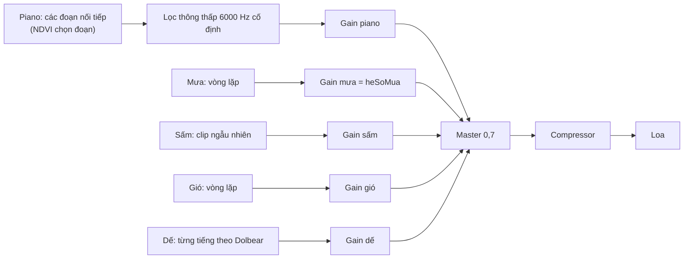

# Green Corner: Tài liệu kỹ thuật hệ thống

Cập nhật: 2026-10-21 · Phiên bản mã: commit `134c2f3` (main) · Bản chạy: https://mlink1415.github.io/green-corner/

Tài liệu này mô tả **hệ thống đang chạy**: kiến trúc, dữ liệu, âm thanh, kiểm thử, triển khai và những giới hạn đã biết. Mọi con số được lấy từ mã nguồn và các file trong kho; chỗ nào chưa kiểm chứng sẽ ghi rõ.

## 1. Tổng quan

Green Corner là web app tĩnh (không có máy chủ riêng) đổi số liệu vệ tinh NASA thành âm thanh và tranh vẽ, dành cho học sinh cấp 2. Sản phẩm dự thi NASA Space Apps Challenge 2026, đề bài *The Earth Information Jukebox*.

| Hạng mục | Giá trị |
| --- | --- |
| Loại ứng dụng | Trang web tĩnh, một file `index.html` (HTML + CSS + JavaScript) |
| Ngôn ngữ, framework | JavaScript thuần, không framework, không thư viện ngoài, không bước build |
| Kích thước | `index.html` 187 KB (2.933 dòng); `assets/` 5,9 MB; `data/` 60 KB |
| Máy chủ | Không có. Chạy hoàn toàn trên trình duyệt người dùng |
| Nguồn dữ liệu NASA | MODIS MOD13Q1 qua ORNL DAAC (NDVI), NASA POWER (nhiệt độ, mưa, gió), NASA Worldview Snapshot (ảnh vệ tinh) |
| Âm thanh | Web Audio API. Nhiệt độ = tiếng dế, lượng mưa = tiếng mưa thật + sấm (bản thu, một thang chung cho mọi nơi, ở cả hai luồng); phủ xanh = giai điệu tổng hợp (luồng theo địa điểm) hoặc đoạn piano (màn thời gian); gió = bản thu (màn thời gian) |
| Ngôn ngữ giao diện | Tiếng Việt và tiếng Anh |
| Triển khai | GitHub Pages, nhánh `main`, thư mục gốc |
| Tài khoản, khóa API | Không cần |

Hai luồng chính của sản phẩm:

- **Khám phá theo địa điểm** (25 nơi): gọi NASA lúc chơi, nghe 3 chỉ số, đố vui, vẽ dự đoán, so sánh với NASA, ghi điểm.
- **Khám phá theo thời gian** (6 nơi): số liệu theo tháng 01/2006 đến 06/2026 đã được tải sẵn thành file, kéo thanh thời gian để nghe piano, mưa, gió thay đổi theo số liệu.

Ngoài ra có chế độ **Đội Tuần Tra Xanh** (xếp hạng điểm theo mức xanh trong một quốc gia) và màn **Green Corner của em** (hành động ngoài đời thật).

## 2. Kiến trúc



Nguyên tắc thiết kế:

1. **Một file, không build.** Dễ đọc, dễ kiểm tra, mở được ngay bằng một máy chủ tĩnh bất kỳ.
2. **Không máy chủ, không tài khoản.** Không có chỗ nào gửi dữ liệu người chơi đi.
3. **Số liệu thật, không bịa.** Lỗi mạng hiện thông báo; tháng NDVI phải ước lượng được đánh dấu và hiện vùng xám.
4. **Tải lười.** Âm thanh và số liệu 20 năm chỉ tải khi người chơi vào màn Khám phá theo thời gian.

## 3. Cấu trúc kho mã

```text
green-corner/
├── index.html               Toàn bộ ứng dụng (HTML, CSS, JS)
├── serve.py                 Máy chủ tĩnh đa luồng, cổng 8010, để chạy thử trên máy
├── README.md                Giới thiệu, hướng dẫn chơi, cách chạy
├── TECHNICAL.md             Tài liệu này
├── assets/audio/
│   ├── piano.mp3            Một bản piano thu sẵn (khoảng 1,0 MB)
│   ├── wind-loop-B.wav      Vòng lặp tiếng gió rừng (khoảng 1,7 MB)
│   ├── rain-loop-v2.wav     Vòng mưa 40 giây, mono 22,05 kHz (khoảng 1,7 MB)
│   ├── thunder.wav          4 clip sấm nối liền, 31 giây (khoảng 1,4 MB)
│   └── cricket-chirps.wav   24 tiếng dế kêu rời nối liền, 5,8 giây (khoảng 0,25 MB)
├── data/
│   ├── piano-slices.json    30 đoạn piano: a, b (giây), r (độ sôi động 0 đến 1)
│   ├── cricket-chirps.json  24 cặp [bắt đầu, kết thúc] (giây): vị trí từng tiếng dế trong cricket-chirps.wav
│   ├── thunder-clips.json   4 cặp [bắt đầu, kết thúc]: vị trí từng clip sấm trong thunder.wav
│   └── series/<nơi>.json    Số liệu theo tháng của 6 nơi (xem mục 6.2)
└── tools/
    ├── build_series.py      Tải NASA, xử lý, ghi data/series
    ├── check_series.py      Kiểm chéo số liệu
    ├── build_dem_mua_assets.py   Tạo lại âm thanh mưa, sấm, dế từ bản thu gốc (cần macOS)
    └── test_*.js, audit_en.js   Bài kiểm thử tự động (Playwright)
```

## 4. Màn hình và điều hướng

Mỗi màn là một thẻ `div.screen` với `id` riêng; chỉ một màn có lớp `active`. Hàm `hienManHinh(id)` bật màn đó, cuộn lên đầu và cập nhật nút "Quay lại" chung.

| Màn | id | Vai trò | Màn cha (nút Quay lại) |
| --- | --- | --- | --- |
| Chào | `man-chao` | Mở đầu, 3 nút | không có |
| Hướng dẫn chơi | `man-huongdan` | Thẻ hướng dẫn | `man-chao` |
| Chọn cách khám phá | `man-chedo` | Theo thời gian hoặc theo địa điểm | `man-chao` |
| Bản đồ 25 nơi | `man-map` | Chọn địa điểm | `man-chedo` |
| Đang tải | `man-tai` | Chờ NASA trả số liệu | (ẩn nút) |
| Lắng nghe | `man-nghe` | Ảnh vệ tinh, 3 nút Nghe | `man-map` |
| Đố vui | `man-doanhinh` | Nghe âm, đoán ảnh | `man-nghe` |
| Học Hỏi | `man-hochoi` | Kiến thức và nguồn dữ liệu | `man-nghe` |
| Vẽ tranh | `man-ve` | Chọn mức cây, nhiệt độ, mưa | `man-nghe` |
| So sánh NASA | `man-sosanh` | Đối chiếu dự đoán, chấm sao | `man-ve` |
| Green Corner của em | `man-gocxanh` | Gợi ý hành động, ghi chú | màn đứng trước |
| Chọn nơi (thời gian) | `man-tg-chon` | 6 nơi có chuỗi 20 năm | `man-chedo` |
| Màn thời gian | `man-thoigian` | Thanh thời gian, 4 biểu đồ, âm thanh | xử lý riêng (xem dưới) |
| Tuần tra: quốc gia | `man-tuantra-quocgia` | Chọn 1 trong 7 nước | `man-chao` |
| Tuần tra: đoán | `man-tuantra-doan` | Xếp hạng điểm | `man-tuantra-quocgia` |
| Tuần tra: kết quả | `man-tuantra-ketqua` | Xếp hạng NASA, chấm sao | `man-tuantra-quocgia` |

Quy ước nút Quay lại (`quayLaiChung`):

- Tra bảng `MAN_QUAY_LAI` để biết màn cha.
- Ngoại lệ: màn thời gian gọi `quayLaiThoiGian()` (dừng timeline và âm thanh, rồi về danh sách hoặc về màn Lắng nghe tùy nơi mở). Màn Green Corner của em về đúng màn vừa đứng trước (`manTruocGocXanh`).
- Mở màn thời gian từ danh sách đặt `THOI_GIAN.nguon = "ds"`; mở từ màn Lắng nghe đặt `"nghe"`.

## 5. Trạng thái trong bộ nhớ

Trạng thái là các biến toàn cục trong một script; không có thư viện quản lý state.

| Biến | Nội dung |
| --- | --- |
| `ngonNguHienTai` | `"vi"` hoặc `"en"` |
| `khuVucHienTai` | id nơi đang chơi ở luồng theo địa điểm |
| `duLieuDaTai[id]` | Số liệu NASA đã lấy cho nơi đó: `ndvi`, `ndviNgay`, `ndviDangTinCay`, `ndviTruoc`, `tempC`, `rainMmNgay`, các giá trị năm trước, `thoiTietGanNhat` |
| `duDoanHienTai`, `luaChonHienTai` | Dự đoán của người chơi ở màn Vẽ |
| `doanHinhHienTai` | Câu đố đang chơi |
| `tuanTraHienTai` | Quốc gia, điểm dữ liệu, thứ tự đã chọn |
| `diemTichLuy` | Tổng số sao (lưu vào `localStorage`) |
| `THOI_GIAN` | Trạng thái màn thời gian: nguồn mở, chuỗi đang xem, vị trí tháng `vt` (số thực), đang chạy, tốc độ |
| `boNhoChuoiTG[id]` | Chuỗi số liệu 20 năm đã tải (giữ lại trong phiên) |
| `AT` | Trạng thái âm thanh màn thời gian: bytes đã tải, buffer đã giải mã, `AudioContext`, đồ thị âm thanh, lịch sử đoạn piano |
| `DOC` | Trạng thái nút Nghe đọc |

## 6. Dữ liệu

### 6.1 Luồng theo địa điểm: gọi NASA lúc chơi

Khi người chơi chọn một nơi, `chonKhuVuc(id)` mở màn Đang tải và `layDuLieuKhuVuc(kv)` gọi **ba việc song song** (`Promise.all`):

| Việc | Hàm | Điểm cuối | Tham số chính | Kết quả |
| --- | --- | --- | --- | --- |
| NDVI | `layNDVIGanNhatDangTin` | `modis.ornl.gov/rst/api/v1/MOD13Q1`: `/dates` rồi `/subset` cho 8 đợt đo gần nhất, song song | `latitude`, `longitude`, `kmAboveBelow=0`, `kmLeftRight=0` | Đợt gần nhất có cờ tin cậy 0 hoặc 1 (kèm đợt tốt ngay trước đó để biết xu hướng); NDVI = giá trị thô × 0,0001 |
| Nhiệt độ, mưa (năm) | `layNhietDoVaMua` | `power.larc.nasa.gov/api/temporal/monthly/point` | `parameters=T2M,PRECTOTCORR`, `community=AG`, năm và năm trước; khóa `…13` là trung bình cả năm | `tempC`, `rainMmNgay` và giá trị năm trước |
| Thời tiết gần nhất | `layThoiTietGanNhat` | `power.larc.nasa.gov/api/temporal/daily/point` | 14 ngày gần nhất, bỏ ngày có giá trị −999 | Ngày mới nhất NASA đã xử lý (độ trễ khoảng vài ngày); lỗi thì bỏ qua, không chặn luồng |

Chi tiết quan trọng:

- Kết quả được lưu trong `duLieuDaTai[id]`, lần sau chọn lại nơi đó không gọi lại.
- Lỗi một trong hai việc đầu: màn Đang tải hiện thông báo "Chưa lấy được dữ liệu NASA, em thử lại nhé!" và dừng, không dùng số giả.
- **Ảnh vệ tinh** không đi qua `fetch`: `urlAnhVeTinh()` ghép URL `wvs.earthdata.nasa.gov/api/v1/snapshot` (lớp `MODIS_Terra_CorrectedReflectance_TrueColor`, khung ±1,5° quanh điểm, đúng ngày NDVI) và gán thẳng vào thẻ `img`. Ảnh lỗi thì hiện "chưa tải được ảnh này", phần còn lại vẫn dùng được.
- Phân loại 3 mức dùng ngưỡng cố định: NDVI dưới 0,3 / 0,3 đến 0,6 / trên 0,6; nhiệt độ dưới 15 / 15 đến 25 / trên 25 °C; mưa dưới 1 / 1 đến 4 / trên 4 mm/ngày (`phanLoaiPhuXanh`, `phanLoaiNhietDo`, `phanLoaiMua`).

### 6.2 Luồng theo thời gian: số liệu tải sẵn

Tải NDVI 20 năm trực tiếp mất khoảng 13 phút mỗi nơi, nên số liệu được **tải trước bằng script** rồi lưu thành file tĩnh. Màn thời gian chỉ `fetch("data/series/<id>.json")` một lần cho mỗi nơi.

Cấu trúc `data/series/<id>.json`:

| Khóa | Kiểu | Ý nghĩa |
| --- | --- | --- |
| `version`, `id`, `built` | số, chuỗi | Phiên bản định dạng, mã nơi, ngày tạo |
| `lat`, `lon` | số | Tọa độ ô vệ tinh 250 m |
| `start`, `n` | chuỗi, số | Tháng đầu (`2006-01`) và số tháng (246) |
| `T`, `P`, `W`, `N` | mảng `n` số | Nhiệt độ (°C), mưa (mm/ngày), gió (m/s), NDVI (0 đến 1), theo tháng |
| `nInterp` | mảng chỉ số | Các tháng NDVI phải nội suy (hiện vùng xám) |
| `stats` | đối tượng | `p02`, `p98`, `min`, `max` cho `N,T,P,W`; `p02` và `p98` là hai đầu thang chuẩn hóa |
| `quality` | đối tượng | Số đợt đo, đợt tốt, đếm theo cờ tin cậy, tỉ lệ tháng nội suy, khoảng trống dài nhất, nội suy theo mùa và theo năm |
| `sources` | đối tượng | Mô tả nguồn NASA và quy tắc xử lý |

Mỗi file khoảng 6 đến 7 KB. Trước khi dùng, `chuoiHopLeTG()` kiểm tra cấu trúc; file hỏng thì màn hiện lỗi kèm nút Thử lại thay vì chạy sai.

**Quy trình tạo số liệu** (`tools/build_series.py`, chỉ dùng thư viện chuẩn Python 3.9+):

1. Đọc tọa độ của nơi từ `index.html` (dòng `{ id: "…", …, lat: …, lon: … }`).
2. Tải 472 đợt đo NDVI 16 ngày kèm cờ độ tin cậy; tải T2M, PRECTOTCORR, WS2M theo tháng từ NASA POWER.
3. Chỉ nhận đợt có cờ 0 hoặc 1; NDVI tháng là trung bình các đợt tốt có ngày bắt đầu trong tháng; tháng thiếu thì nội suy tuyến tính và ghi vào `nInterp`.
4. Kiểm khoảng giá trị hợp lý, tính `p02`/`p98`, ghi file rồi đọc lại kiểm lần nữa trước khi thay file thật (ghi nguyên tử).
5. Có bộ nhớ tạm `~/.cache/green-corner-series`, chạy dở thì chạy tiếp được.

`tools/check_series.py` kiểm chéo độc lập: tháng nóng, lạnh, mưa nhiều nhất đúng mùa của từng nơi; so 4 tháng mỗi nơi với NASA POWER gọi trực tiếp; tính lại NDVI từ dữ liệu thô bằng đoạn mã khác và so ở mọi tháng không nội suy.

**Hai nơi thêm sau** (Diên An / An Tái và Rondônia) nằm trong `KHU_VUC_THOI_GIAN`, không thuộc 25 nơi của bản đồ. Điểm đo được chọn bằng cách so ảnh NDVI mùa hè 2006 với 2025 trong bán kính 10 km (xem README).

`data/piano-slices.json` gồm 30 phần tử `{ a, b, r }`: bắt đầu, kết thúc (giây) và độ sôi động `r` từ 0 đến 1 của từng đoạn piano. Được tạo một lần bằng phân tích âm thanh (librosa), không nằm trong kho này.

## 7. Âm thanh

Dùng chung một `AudioContext` (`layAudioContext()`) cho mọi âm thanh, nên trình duyệt chỉ tạo một. Mỗi loại số liệu có **một loại âm riêng**, và hai loại dưới đây dùng **MỘT THANG CHUNG tuyệt đối** (°C, mm/ngày) cho mọi địa điểm, ở cả hai luồng:

| Số liệu | Âm thanh | Thang chung | Hàm |
| --- | --- | --- | --- |
| Nhiệt độ | Tiếng dế kêu rời, lấy từ bản thu thật | Định luật Dolbear: tiếng kêu mỗi giây = (1,8 × °C + 32 − 40) / 15; dưới ~4,4 °C dế im | `tocDoDeTuNhiet(tC)` |
| Lượng mưa | Vòng mưa thật; thêm tiếng sấm khi mưa to | Mưa to dần theo log: từ −30 dB (rất nhẹ) đến 0 dB (từ 25 mm/ngày), cộng 4 dB bù; dưới 0,05 mm im. Sấm từ 8 mm/ngày: 0,5 đến 3,5 lần mỗi phút (màn thời gian) hoặc 1 tiếng (luồng địa điểm) | `mucMuaDB(mm)`, `heSoMua(mm)`, `nhipSamMoiPhut(mm)` |
| Phủ xanh | Giai điệu 3 mức (luồng địa điểm); đoạn piano theo độ sôi động (màn thời gian, chuẩn hóa theo từng nơi) | Ngưỡng 0,3 và 0,6 (luồng địa điểm); p02 đến p98 của nơi đó (màn thời gian) | `phatAmPhuXanh`, `chonDoanPianoTG` |
| Gió (chỉ màn thời gian) | Vòng gió rừng thật | Theo từng nơi (p02 đến p98), dB `−42 + 42 × x^0,8` | `apDungMucAmThanhTG` |

Các hằng số nằm trong khối `AM_MOI` và `tocDoDeTuNhiet`, `mucMuaDB` ngay trước `DUONG_AM_THANH`. Tài nguyên (vòng mưa, sấm, dế, hai danh sách clip) được **tải một lần chung** cho cả hai luồng qua `layBytesMoi()` (`KHO_MOI`), nên vào cả hai luồng cũng không tải lại. Cách tạo các file: `tools/build_dem_mua_assets.py` (mưa: lấy đoạn đều 150 đến 192 giây của bản thu, làm đều độ to để dao động giữa các cửa sổ 4,5 giây chỉ còn 1,4 dB, nối mượt đầu cuối; sấm: 4 clip có vào ra mềm; dế: 24 tiếng sạch, tách biệt, cùng mức RMS).

### 7.1 Luồng theo địa điểm

Mỗi nút **Nghe** phát khoảng 4,5 giây (`DD.dai`):

- **Nhiệt độ** (`phatAmNhietDo`): `n = max(1, làm tròn(tốc độ × 4,5))` tiếng dế rải đều, mỗi tiếng chọn ngẫu nhiên một clip trong ngân hàng, không lặp liên tiếp, lệch trái phải nhẹ; dưới ~4,4 °C không phát và có ghi chú chữ "dế im lặng".
- **Mưa** (`phatAmMua`): vòng mưa vào ra mềm 0,4 giây, độ lợi `heSoMua(mm)`, điểm bắt đầu ngẫu nhiên trong vòng; từ 8 mm có thêm một tiếng sấm. Gần như không mưa thì im, có ghi chú chữ.
- **Phủ xanh** (`phatAmPhuXanh`): giai điệu 3 mức tổng hợp như trước (cao độ tinh chỉnh ±35 cent, nốt bè xu hướng).
- Âm thanh mới được nạp trước khi vào màn Lắng nghe (khoảng 3,4 MB, `taiAmThanhDiaDiem`) và qua một đường ra riêng gồm gain 0,7 và bộ nén (`ddDauRa`). Nạp lỗi thì nút Nghe tự dùng giai điệu cũ (`phatAmNhietDoCu`, `phatAmMuaCu`), không im.

### 7.2 Màn Khám phá theo thời gian



- **Nội suy:** `giaTriMuotTG` nội suy tuyến tính giữa hai tháng nên âm thanh đổi mượt khi kéo hoặc chạy; `apDungMucAmThanhTG` chạy mỗi 80 ms và cập nhật độ lợi mưa, gió, piano, dế, sấm.
- **Piano:** `lenLichPianoTG` xếp trước đoạn kế tiếp khoảng 1,6 giây theo đồng hồ của `AudioContext` (mỗi 150 ms kiểm tra). `chonDoanPianoTG` lấy 3 đoạn có `r` gần mức NDVI (chuẩn hóa theo từng nơi) nhất, loại đoạn đã phát trong 6 lần gần đây, rồi bốc ngẫu nhiên một. Bộ lọc piano giờ **cố định 6000 Hz** (nhiệt độ do tiếng dế biểu diễn).
- **Dế:** `lenLichDeSamTG` (cùng đồng hồ 150 ms) lên lịch từng tiếng dế với nhịp `1 / tốc độ` nhân hệ số ngẫu nhiên 0,8 đến 1,2. Khi nhiệt độ tăng mạnh, nhịp đã định mà dài hơn 1,6 lần nhịp mới thì được kéo sớm lại, nhưng không bao giờ sớm hơn tiếng dế đã lên lịch gần nhất (`AT.deUltim`), nên không có tiếng nào bị lên lịch hai lần. Dưới ~4,4 °C hoặc khi tắt dế thì chờ.
- **Mưa và sấm:** độ lợi mưa = `heSoMua(mm của tháng)` × bình phương âm lượng nền; sấm chỉ khi nền thiên nhiên là mưa hoặc cả hai và mưa từ 8 mm/ngày, tối đa một tiếng mỗi 6 giây.
- **Gió:** độ to theo dB, `−42 + 42 × x^0,8`, x chuẩn hóa theo từng nơi.
- **Tùy chỉnh:** nền thiên nhiên chọn được gió, mưa hoặc cả hai (**mặc định: cả hai**); có ô bật tắt và thanh âm lượng riêng cho dế. Dòng trạng thái hiện nhịp dế hiện tại hoặc "dế im lặng".
- **Tải:** `taiByteAmThanhTG()` chỉ tải byte (piano, gió, danh sách đoạn piano và bộ mưa, sấm, dế từ kho chung); giải mã (`decodeAudioData`) làm ở lần Phát đầu, vì trình duyệt yêu cầu bật âm thanh trong lúc xử lý cú bấm. Hỗ trợ cả dạng callback (Safari cũ) và promise.
- **Dọn dẹp:** `tatAmThanhTG()` giảm âm lượng dần, dừng nguồn, ngắt đồ thị, giải phóng buffer đã giải mã và xóa lịch dế, sấm; byte đã tải được giữ lại để lần sau không phải tải lại.
- **Bị ngắt:** `xuLyDoiTrangThaiAmThanhTG` xử lý khi hệ thống tạm dừng âm thanh (cuộc gọi, ngủ máy, đổi tai nghe) và hồi sinh trong lần bấm Phát kế tiếp.

Cơ sở khoa học của tiếng dế và công thức đầy đủ nằm trong README và trong tài liệu "Trả lời ban giám khảo: từ số liệu NASA đến âm thanh" (đã viết cho bản trước, phần mưa và nhiệt độ cần đọc kèm mục này).

## 8. Giao diện

- **Bố cục:** khung "điện thoại" `.phone` rộng tối đa 380 px, một cột; thẻ `viewport` chuẩn. Kiểm tra ở 360×640, 390×844, 768×1024 không tràn ngang.
- **Chạm:** biểu đồ thời gian dùng `pointerdown/move/up` (ăn cả chuột và cảm ứng); các nút chính của màn thời gian cao 55 px (đã đo).
- **Vẽ:** cảnh quan vẽ bằng `canvas` (`veCanhQuan`), có hạt giống theo tên nơi nên cảnh của một nơi luôn giống nhau. Biểu đồ thời gian là SVG: đường mảnh là giá trị từng tháng, đường đậm là trung bình trượt 12 tháng quanh điểm, vùng xám là tháng NDVI nội suy.
- **i18n:** từ điển `TU_DIEN` có hai khóa `vi` và `en`. `T(khoa, tham số)` tra từ điển, thiếu thì lùi về tiếng Việt, rồi về chính khóa; `{tham số}` được điền bằng `split/join`. Phần tử tĩnh gắn `data-i18n` được `apDungNgonNgu()` ghi lại; **chữ động trên màn thời gian không gắn `data-i18n`** mà tự vẽ lại (`veLaiNhanTG`), vì `apDungNgonNgu` ghi đè `innerHTML`. Lời giải thích màn thời gian nằm trong `NARRATION`, thẻ "Về nơi này" nằm trong `TG_NOI`; các con số trong thẻ được tính từ file số liệu.
- **Nghe đọc:** dùng Web Speech API của trình duyệt (`speechSynthesis`); nút tự ẩn nếu máy không có giọng đúng ngôn ngữ. Chữ được chuẩn hóa trước khi đọc (bỏ biểu tượng, đọc số, đơn vị, viết tắt) và chia đoạn ngắn.
- **Truy cập:** mọi nút có chữ, thanh thời gian có `aria-label` nêu khoảng thời gian, các ô điều chỉnh có `label`, thanh thời gian dùng được bằng phím mũi tên.

## 9. Lưu trữ cục bộ và quyền riêng tư

| Khóa `localStorage` | Nội dung |
| --- | --- |
| `greenCorner_ngonNgu` | `vi` hoặc `en` |
| `greenCorner_diem` | Tổng số sao |
| `greenCorner_ghiChu` | Ghi chú ở màn Green Corner của em |

Mọi truy cập `localStorage` bọc trong `try/catch`, nên app vẫn chạy khi trình duyệt chặn lưu trữ. Không có cookie, không có tài khoản, không có phân tích hành vi, không có máy chủ nhận dữ liệu. Ghi chú không bao giờ được gửi đi.

Các yêu cầu mạng ra ngoài chỉ gồm: ba dịch vụ NASA ở trên, và file tĩnh cùng nguồn gốc (`index.html`, `data/`, `assets/`). Bài test màn thời gian xác nhận màn này chỉ gọi đúng một nguồn gốc (nguồn của chính trang).

## 10. Xử lý lỗi và độ bền

| Tình huống | Hành vi |
| --- | --- |
| NASA lỗi hoặc rớt mạng khi chọn nơi | Thông báo thân thiện, không dùng số giả, người chơi chọn lại được |
| Ảnh vệ tinh Worldview lỗi (thỉnh thoảng báo 503) | Hiện "chưa tải được ảnh này", phần còn lại vẫn chạy |
| Mất mạng trong màn thời gian sau khi đã tải | Vẫn phát, tạm dừng được |
| Vào nơi chưa tải khi mất mạng | Thông báo lỗi và nút Thử lại; có mạng lại bấm Thử lại là nạp được |
| Mở `index.html` bằng `file://` | Màn thời gian báo lỗi nạp số liệu và có nút Thử lại, không treo (luồng cần `fetch` nên nên chạy qua máy chủ) |
| Tải âm thanh lỗi | Biểu đồ vẫn xem được không tiếng; bấm Phát sẽ thử lại |
| Người chơi thoát giữa lúc đang tải hoặc chuẩn bị âm thanh | Kết quả đến muộn bị bỏ qua, không vẽ nhầm màn |
| Trình duyệt chặn `localStorage` | Bỏ qua, điểm và ghi chú không lưu |

Các lời gọi `fetch` tới NASA **không có thời gian chờ riêng** (không dùng `AbortController`); thời gian chờ phụ thuộc trình duyệt.

## 11. Hiệu năng

Số đo từ bài test `test_s5.js` và `test_amthanh.js` (Chromium, máy phát triển):

| Chỉ tiêu | Kết quả |
| --- | --- |
| Biểu đồ màn thời gian hiện | 0,1 đến 0,2 giây (không chờ âm thanh) |
| Tải xong âm thanh | khoảng 5,5 giây trên 4G nhanh (9 Mbps); 30,7 giây trên 3G nhanh (1,6 Mbps) |
| Từ lúc bấm Phát đến có tiếng (đã tải) | khoảng 0,1 giây |
| Bộ nhớ giải mã âm thanh | khoảng 43 MB (gồm vòng mưa, sấm, dế) |
| Vào, Phát, thoát lặp 8 lần | bộ nhớ JS tăng 0,2 MB; không còn buffer, đồ thị âm thanh hay bộ đếm thời gian nào treo |

Dung lượng tải thêm khi vào màn thời gian: khoảng 6 MB (âm thanh và số liệu). Luồng theo địa điểm tải trước khoảng 3,4 MB khi vào màn Lắng nghe; hai luồng dùng chung kho tải nên không tải lặp.

## 12. Kiểm thử

Bài test viết bằng Playwright (Node.js), không phải một công cụ CI: chạy tay trên máy phát triển. Cách chạy:

```bash
cd green-corner
python3 serve.py                          # cổng 8010 (máy chủ đa luồng), để chạy ở cửa sổ khác
NODE_PATH=<thư-mục-có-playwright> node tools/test_thoigian.js
```

| Bài test | Kiểm gì |
| --- | --- |
| `test_thoigian.js` | Số liệu, kéo thanh, phát, ngôn ngữ của màn thời gian |
| `test_amthanh.js` | Mức âm, không vỡ tiếng, độ dài giải mã, RAM, dế theo nhiệt độ, lỗi, bị ngắt, tải một lần |
| `test_dem_mua.js` | Dế và mưa + sấm theo MỘT THANG CHUNG ở cả hai luồng: nhịp dế theo Dolbear, độ lợi mưa, sấm chỉ từ 8 mm, nơi khác nhau cùng giá trị thì nghe như nhau, dế/mưa im, lời giải thích VI/EN, nạp lỗi thì dùng giai điệu cũ |
| `test_chedo.js` | Màn chọn cách khám phá, danh sách 6 nơi, thứ tự |
| `test_quaylai.js` | Nút Quay lại ở mọi màn (cần mạng) |
| `test_noi.js` | Thẻ "Về nơi này": đối chiếu số với số liệu gốc cho cả 6 nơi, tiếng Việt và tiếng Anh |
| `test_loi.js` | Thẻ lời song ngữ, độ dài câu |
| `test_doc.js` | Nút Nghe đọc (giọng giả): ẩn hiện, văn bản đọc, tự dừng |
| `audit_en.js` | Rà chữ tiếng Việt sót khi bật tiếng Anh (cần mạng) |
| `test_s5.js` | Toàn diện (9 phần): mọi nơi, điện thoại, mạng chậm, rò bộ nhớ, ngoại tuyến, `file://`, CPU chậm, luồng cũ với NASA thật, truy cập cơ bản |
| `check_series.py` | Kiểm chéo số liệu (mục 6.2) |

Kết quả gần nhất (2026-10-21, sau khi đổi sang tiếng dế và mưa mới): tất cả bài test đạt.

**Những gì chưa kiểm chứng:** nghe thử bằng tai trên nhiều thiết bị (bài test chỉ đo số: mức âm, không vỡ tiếng, đổi đúng theo số liệu); `StereoPanner` (dùng để lệch trái phải tiếng dế) chưa thử trên Safari cũ (nếu thiếu thì tự bỏ qua); điện thoại iPhone/Safari thật (độ lệch thời gian `DO_LECH_PIANO = 0` chỉ đo ở Chromium); quét mã QR ngoài đời thật; bài test không bắt được lỗi nằm trong chính file số liệu vì app và test cùng đọc file đó (đã bù bằng `check_series.py` so với NASA).

## 13. Triển khai và vận hành

- **Chạy thử trên máy:** `python3 serve.py` rồi mở `http://localhost:8010`.
- **Phát hành:** đẩy lên nhánh `main` của https://github.com/Mlink1415/green-corner; GitHub Pages tự phục vụ thư mục gốc. Không có bước build, không có tệp cấu hình triển khai.
- **Cập nhật số liệu:** `python3 tools/build_series.py --ids yanan,rondonia,hanoi,cantho,phoenix,newyork` (khoảng 13 phút mỗi nơi, có thể chạy tiếp), rồi `python3 tools/check_series.py`.
- **Bộ nhớ đệm của trình duyệt:** tên file không có mã băm, nên sau khi phát hành người dùng có thể thấy bản cũ vài phút đến khi tải lại.

### Thêm một nơi mới vào màn thời gian

1. Thêm một dòng `{ id, ten, tenEn, moTa, moTaEn, emoji, mau, lat, lon }` vào `KHU_VUC_THOI_GIAN` (một dòng, đúng định dạng để script đọc được tọa độ).
2. Thêm `id` vào `CO_CHUOI_THOI_GIAN` (thứ tự trong mảng là thứ tự trên màn).
3. Thêm mô tả vào `TG_NOI[id]` (`vi`, `en`, tùy chọn `hoi`).
4. Thêm khoảng tháng cực trị cho nơi đó vào `MUA_VU` trong `tools/check_series.py`.
5. Chạy `build_series.py --ids <id>` rồi `check_series.py --ids <id>`.
6. Cập nhật chữ "N nơi" (VI và EN) trong `TU_DIEN`, README, và `tools/test_chedo.js`, `tools/test_noi.js`.
7. Chạy toàn bộ bài test ở mục 12.

## 14. Giới hạn kỹ thuật và nợ kỹ thuật đã biết

| Vấn đề | Tác động | Hướng xử lý gợi ý |
| --- | --- | --- |
| Năm lấy nhiệt độ và mưa của luồng theo địa điểm đang **gán cứng là 2025** (`layDuLieuKhuVuc`) | Sang năm 2027 vẫn hiển thị số của 2025 và ghi "năm 2025" | Lấy năm hiện tại trừ 1, hoặc năm mới nhất đã có số |
| Lời gọi NASA không có thời gian chờ riêng | Mạng treo có thể làm màn Đang tải chờ lâu | Thêm `AbortController` với thời gian chờ và thông báo |
| Phủ xanh vẫn dùng hai cách khác nhau (giai điệu ở luồng địa điểm, piano ở màn thời gian, ngưỡng và thang khác nhau) | Dễ lệch khi sửa một bên | Cân nhắc thống nhất như đã làm với dế và mưa |
| Chỉ một bản thu dế, nên mọi tiếng cùng chất giọng | Ở nhịp cao nghe như một con dế kêu lặp, không giống đàn dế | Thêm bản thu nhiều con, hoặc ghép nhiều ngân hàng |
| Định luật Dolbear vốn của dế cây tuyết, loài trong bản thu chưa rõ | Là ánh xạ thiết kế gần đúng, không phải số đo | Đã ghi "gần đúng" trong lời giải thích; có thể hiệu chỉnh theo bản thu |
| Vòng mưa đã làm đều độ to (mất bớt biến thiên tự nhiên) | Mưa ít "giật" hơn bản gốc | Cần để cùng lượng mưa luôn nghe to như nhau |
| Toàn bộ mã, CSS, từ điển trong một file 177 KB | Khó chia việc, khó đọc diff | Tách file khi nhóm cần, vẫn giữ không bước build |
| Mỗi nơi chỉ là một ô 250 m; NASA POWER có lưới thô hơn nhiều | Không đại diện cho cả vùng; nhiệt độ, mưa, gió không cùng ô với NDVI | Đã ghi rõ trong thẻ "Về nơi này"; có thể lấy trung bình vùng nếu cần |
| 35% đến 62% tháng NDVI (ở 4 nơi cũ) là số ước lượng | Xu hướng phủ xanh chỉ để tham khảo | Đã hiện vùng xám và chú thích; có thể thêm nguồn NDVI khác |
| Chưa thử iPhone/Safari thật | Có thể lệch thời gian piano hoặc chặn tự phát âm thanh | Thử trên thiết bị thật, đo lại `DO_LECH_PIANO` |
| Giọng đọc phụ thuộc máy | Một số máy không có giọng tiếng Việt, nút tự ẩn | Giữ nguyên; kịch bản thu giọng thật là việc sau |
| Âm thanh Pixabay chưa ghi tên bài và tác giả trong app | Giấy phép Pixabay không bắt buộc, nhưng nên ghi nếu có | Bổ sung vào mục Ghi nhận |
| Nguồn và giấy phép của bản thu mưa, sấm và dế mới mới chỉ ghi "do nhóm cung cấp" | Cần ghi rõ khi dự thi | Nhóm bổ sung nguồn từng file vào README và dòng nguồn trong app |
| Luồng theo địa điểm tải trước khoảng 3,4 MB khi vào màn Lắng nghe | Tốn dữ liệu trên mạng chậm | Chỉ tải khi bấm Nghe lần đầu, hoặc hạ chất lượng vòng mưa |

## 15. Thuật ngữ

| Thuật ngữ | Nghĩa |
| --- | --- |
| NDVI | Chỉ số độ xanh thực vật, thang 0 (đất trống) đến 1 (cây rất rậm); đo độ xanh, không đếm cây |
| MOD13Q1 | Sản phẩm chỉ số thực vật 16 ngày, ô 250 m của vệ tinh MODIS/Terra |
| Cờ độ tin cậy | 0 tốt, 1 tạm ổn, 2 tuyết hoặc băng, 3 mây; app chỉ nhận 0 và 1 |
| NASA POWER | Dịch vụ số liệu khí tượng của NASA (T2M, PRECTOTCORR, WS2M) |
| p02, p98 | Phần trăm thứ 2 và thứ 98 của chuỗi, dùng làm hai đầu thang chuẩn hóa |
| Nội suy | Ước lượng tháng thiếu số đo từ các tháng gần nhất; hiện vùng xám |
| Sonification | Biến dữ liệu thành âm thanh |
